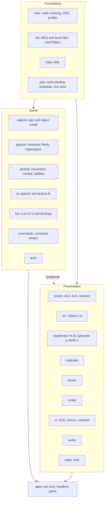

# Empire at War: Vulkan

A from-scratch C++20 rewrite of the *Star Wars: Empire at War: Forces of Corruption* engine (Petroglyph's "Alamo"),
written in its own words: a headless, multithreaded, deterministic simulation core with a Vulkan 1.3 renderer on top.
The goal is the game you already own, running on an engine that uses a modern PC.

**Windows (x64) only, single player only.** Multiplayer, other platforms, RenderDoc support and loading the original
game's save files are out of scope by design. **Forks are welcome:** if you want something this project leaves out, fork
it and add it. The code is released into the public domain under [the Unlicense](LICENSE).

> **AI-assisted development.** This project is built with heavy use of AI coding agents (Anthropic's Claude, through
> Claude Code). Most of the engine code, tests, tools and documentation, including the behaviour specs in `docs/re/`,
> were written by AI agents working under the direction of the maintainer, who sets the goals, makes the design
> decisions, plays the test builds and decides what lands. Agents also read the original binary and drive the original
> game for in-game checks. Every change goes through the same build, test and determinism gates, but expect mistakes,
> and treat the specs as reconstructions rather than authoritative documentation of the original game.

This repository contains **no game assets and no original code**. You need your own copy of the game (Steam:
*Star Wars: Empire at War - Forces of Corruption*). Behaviour was recovered by studying the shipped binary and data and
is written up as specs in [`docs/re/`](docs/re/) (about 230 documents) before the engine follows it.

**Contents:** [Status](#status) · [Goals](#goals) · [Features](#features) · [Performance](#performance) ·
[Architecture](#architecture) · [Quality](#quality-and-process) · [Building](#building-and-running) ·
[Layout](#repository-layout) · [Legal](#legal)

---

## Status

**Active development; playable end to end** through its own host, `alamo_game`, started from the **Command Center**
launcher or a double-click `Play.exe` in packaged test builds. Simulation, renderer, Lua layer, AI, UI, story and
save/load are in place, and *Thrawn's Revenge* loads and plays. Packaged test builds are handed out by the maintainer;
there is no public download yet.

**Current focus: parity with the original.** Rules, data and feel must match exactly; random-driven outcomes must match
by their distribution over many seeds. Internals, performance and save-format work are paused. Named exceptions: the
graphics and display menu and port features for space battles, the all-core simulation redesign, and the mod system.

| Area | State |
|---|---|
| Galactic and tactical simulation, economy, fleets, story campaigns, skirmish, save/load | Built and playable; remaining work is parity polish |
| Land and galactic AI | Follow the original's rules; the land skirmish AI is checked against retail runs by its distribution over seeds |
| Interface, story and tutorial presentation | Built; **a full playtest is still open** |
| Graphics and display menu (SMAA / TAA / MSAA, FSR and XeSS upscaling, render and UI scale) | Built; FSR and XeSS have not been checked in game yet |
| Audio | Core, battle and many retail-read tactical lines are in; announcer, unit voices and some effects are open |
| Mod system (goal: near-full compatibility with Forces of Corruption mods) | In progress; checked on four reference mods and a graded corpus of every installed mod |
| Parity check against the original | A harness and baseline from retail runs exist; the Geonosis skirmish and a few galactic AI metrics are open |
| All-core simulation | In progress (job system, services phase graph and parallel checksums done; tactical AI lane under way) |
| Test suite | 294 tests green on MSVC and clang at the last full run (2026-11-17); two slow tests have failed on `dev` since 2026-11-19 and are being traced |

Per-task status is kept on the project roadmap, in its own repository
([Empire-Vulkan-Brenach](https://github.com/Gabriel-Barney/Empire-Vulkan-Brenach)), so there is one copy for every
working session. Phase results and notes: [`docs/PHASE2.md`](docs/PHASE2.md), [`docs/PHASE3.md`](docs/PHASE3.md),
[`docs/PHASE4.md`](docs/PHASE4.md); every document is indexed in [`docs/README.md`](docs/README.md).

---

## Goals

1. **Play the real game.** Base *Forces of Corruption* is the parity target: the same content, rules and feel. Parity is
   judged by **behaviour** (travel and build times, damage, income, AI choices, battle outcomes), not by matching the
   original's internal hashes. Outcomes that depend on random draws match the original's distribution over many seeds;
   internals such as the order of random draws are the port's own choice and are recorded as such.
2. **Near-full compatibility with Forces of Corruption mods, without special-casing any of them.** A mod that uses the
   original's data mechanisms (XML, Lua, asset formats, shaders) should play as it does in the original. No engine code
   may depend on a mod's names or content. What "plays" means and the mods it is checked on: [`docs/MODS.md`](docs/MODS.md) §10.
3. **Use the whole PC.** The original runs simulation and rendering on one thread over Direct3D 9. This port spreads work
   over every core, keeps big AI and script updates off single ticks, and drives the GPU through Vulkan.
4. **Deterministic by design.** The same inputs give the same results on any number of threads, on any run, and on both
   supported compilers. That is what makes saves, replays, parallelism and debugging trustworthy.
5. **Quality-of-life the original never had.** Smooth motion at any refresh rate, modern anti-aliasing, upscaling and
   ambient occlusion, pause on both levels, a free camera, order queues, fleet groups and built-in profiling tools. These
   change no rule of the original unless the player turns them on.

**Side goals** (not required for a playable game): the all-core simulation redesign
([`docs/SIM_PARALLEL_DESIGN.md`](docs/SIM_PARALLEL_DESIGN.md)), and a repeatable benchmark (fixed saves, recorded orders,
scripted camera, per-tick CRCs proving each run matched; its in-game screen is still open).

---

## Features

Features marked *built* are implemented and tested but wait for the maintainer's in-game playtest.

**Simulation and game rules**
- Full object model (about 4,000 unit definitions) and the original behaviour set, from written specs in `docs/re/`.
- **Galactic layer:** economy, production, fleets and hyperspace, garrisons, fog of war, black market, sabotage, hacking,
  hero respawn, corruption, special weapons, and the galactic abilities (Death Star, planet bonuses, Neutralize, Siphon).
- **Tactical layer:** land and space combat, formations, abilities, hardpoints, garrisons and hangars, landing drops,
  weather, construction pads, reinforcement and victory conditions.
- **Land movement as the original does it:** squads as one container on formation slots, collision decisions, attack
  and garrison approaches, hover units, hero clashes, the vehicle thief, Bribe, Hack and bombing runs.
- **Animation-timed gameplay:** transports unload on their landing clip, AT-AT troopers rope down, land spawners open and
  close, tow cables wrap.
- **Maps:** every retail land and space map loads with its placements, structure markers and radar picture.
- **Story campaigns** with the original event system, linked story battles and corruption missions; **skirmish and
  galactic conquest**, including Capture Control Points and the main-menu attract battle.
- **Skirmish from the front end** with the original's options, more than two players in teams, and an AI difficulty per
  slot that can change during the game.

**AI and scripting**
- The original galactic and tactical AI (goals, plans, task forces, learning) and its Lua perception and plans, on a
  vendored **Lua 5.0.2** with the original semantics, plus a full Lua binding layer for objects, players, story, fog,
  presentation and scoring.

**Renderer (Vulkan 1.3)**
- Synchronization2, bindless textures, a persistent on-disk pipeline cache and draw recording across all cores.
- The original's shaders are translated to SPIR-V by an in-house HLSL-bytecode translator plus DXC; **all 291 shipped
  shaders translate**.
- Terrain, water, decals, tracks, stencil shadows, fog of war, space backdrops, hardpoint destruction and GPU particles.
- Presentation-only options never feed the simulation, so they cannot change a battle.

**Graphics and display options** (separate Display and Graphics pages)
- Sim ticks at 30 Hz; views interpolate, so motion is smooth at 60, 144 or 240 Hz.
- Fullscreen (exclusive), Borderless or Windowed; V-sync (Off, FIFO, Mailbox) and a frame-rate cap.
- Anti-aliasing: **SMAA**, **TAA** or **MSAA 2x / 4x / 8x**. Upscaling: **AMD FSR** or **Intel XeSS** (*built*; a missing
  DLL or unsupported GPU falls back to TAA).
- Render scale, UI scale, screen-space ambient occlusion in land battles, anisotropic filtering up to 16x, and a
  frame-time overlay (F11).

**Controls and port features** (not in the original; each goes through the command stream, so replays and saves carry it)
- Pause on both levels, adjustable field of view, a free tactical camera, Shift+click order queues.
- Fleet groups (off by default), fleet cohesion (Loose is retail), fighter and bomber wing buttons, fleet and ship
  names, optional unit path lines.

**Interface:** the original menus and HUD drawn from the original dialog data, fonts and art; skirmish setup that follows
the original's staging rules with Official and Custom (mod) map lists; galactic and tactical HUDs; story and tutorial
presentation; key rebinding; save and load dialogs that list saves as a tree.

**Save and load:** the port's own compact format (a story save is about 50-60 KB), galactic and **mid-battle** saves,
replay of recorded command streams. Saves include scheduled background AI work, so a loaded run continues tick for tick.

**Tooling**
- `alamo_headless` runs the whole simulation without a window, for tests, benchmarks and AI experiments; it records
  **per-tick state checksums** and a **tick profiler** (`--profile`).
- **Mod load report** (`alamo_mod_check`) and a mod picker in the game's menus: loader diagnostics, missing files,
  unread tags and failing scripts, from one mod environment shared by the game, `alamo_play`, `alamo_mod_check` and the
  Command Center. A corpus runner grades every installed mod.
- **Parity tooling** (`tools/probe_mod/`, `tools/parity/`): a recorder that samples the original game per tick, in-game
  probe mods, and a harness that replays recorded scenarios in the port and grades timings, income, AI choices, damage
  and outcomes against tolerances from several retail runs.
- **Benchmark tooling**, **visual regression** screenshot checks, and tools for the original formats (MEG, ALO/ALA, shaders).
- **Command Center** (`launcher/`, Rust and egui): starts the game with profiles, mods, saves, graphics options and
  diagnostics. A separate program that never links engine code.
- **Test builds** (`tools/testbuild/`): the game packaged with the Command Center and a `Play.exe` that finds the game
  install by itself.

---

## Performance

The simulation runs on a work-stealing job system with order-stable results; AI players' clocks are staggered, long AI
work runs as fixed-latency background jobs, and the renderer records on several threads. Everything is scheduled **by
tick number, never by wall clock or thread timing**, so results are bit-identical for any worker count. The budget is p99
under 16.7 ms and no tick over 33.3 ms: p99 is met in every measured scenario, and the one miss is the setup tick that
starts a battle. Measurements (AMD Ryzen 7 7800X3D), what each fix bought, and what was tried and not shipped are in
[`docs/PERFORMANCE.md`](docs/PERFORMANCE.md). Other performance work is paused for parity, except the all-core redesign.

---

## Architecture



- **One static library per module**, each with its own test executable.
- **The sim never reads presentation state.** The renderer and UI consume interpolated snapshots of the sim.
- **Everything the player does is a command** in a stream (orders, pause, queued orders, retreat). The stream plus the
  initial state fully determines a run, which is what makes replays, saves and the CRC checks work.

### The determinism contract
Results read by game logic must be bit-identical across thread counts, runs, and the MSVC and clang builds:
- Parallel jobs write **per-index outputs**; reductions run **in index order**.
- No FMA contraction (`/fp:precise`, `-ffp-contract=off`).
- No iteration over pointer-keyed or seeded-hash containers in sim code.
- Scheduling (AI stagger, background-job latency, GC timing) depends on **tick numbers only**; timing data is write-only.

It is checked by recording a per-tick CRC (with a per-system breakdown) and comparing logs across 0, 1, 4, 16 and
(hardware threads - 1) workers, naming the first diverging tick and system. Clang's logs equal MSVC's.

---

## Quality and process

- **Two compilers.** MSVC ships; clang 20 checks (`-Wconversion -Wshadow`) and is a second compiler for determinism.
  Sim changes get both; threading changes also run under a sanitizer. **Zero warnings** at MSVC `/W4 /permissive-` and
  clang `-Wall -Wextra -Wpedantic -Wconversion -Wshadow`.
- **About 300 tests**, with golden-file checks of whole battles and campaigns compared across worker counts. A fast tier
  (about 200 tests) is what quick iteration and landing run.
- **Pre-merge gate** (`build_gate.cmd`): MSVC, clang and sanitizer builds. Landing on `dev` refuses a merged result without
  a passing MSVC build and fast-tier run, so `dev` is never pushed red. **`dev`** is the development branch (GitHub's
  default); `main` is the released branch, updated from `dev` once the full gate passes.
- **Parity is checked against the real game.** A question about the original goes first to the binary (read through
  Ghidra and tracing tools); reference traces recorded from the original and in-game probe runs settle what only the
  running game shows. Each answer is written into the matching spec before the engine follows it.
- **Parallel agent workflow.** Work is split by roadmap group across agent sessions, each in its own git worktree. Every
  group has an exit test; polish findings go to a triaged backlog and become work only when picked. Rules: [`CLAUDE.md`](CLAUDE.md).
- **Own words, never copied.** Workers may read the decompiled original, but decompiled code is never copied into the
  repository: engine code is written in the port's own words, and behaviour goes into `docs/re/` in words and tables.
- **Third-party code** in `engine/` is limited to approved dependencies: Vulkan-Headers, DXC, VMA, Lua 5.0.2, miniaudio,
  FFmpeg's Bink decoder (LGPL, dynamically linked), the reference SMAA, and the AMD FidelityFX (FSR) and Intel XeSS
  runtime DLLs (optional, loaded at run time). Tool versions: [`docs/BUILD.md`](docs/BUILD.md).
- About **520,000 lines** of C++ in `engine/` (tests included), across 21 modules plus a shared test-support library.

---

## Building and running

> **A fresh clone cannot be built yet.** The build uses a project-local toolchain under `toolchain\` (MSVC, Windows SDK,
> CMake, Ninja, DXC, LLVM) that is rebuilt by setup scripts on the maintainer's PC; the toolchain folder, its scripts,
> the game data and the roadmap are **not stored in this repository**. With your own MSVC, CMake and Ninja you can read
> the scripts below to see how it is built. Full build and test rules: [`docs/BUILD.md`](docs/BUILD.md).

```bat
build_msvc.cmd        :: configure, build and run all tests with MSVC
build_clang.cmd       :: the clang 20 check build
build_asan.cmd        :: sanitizer build of the sim modules
build_gate.cmd        :: MSVC + clang + sanitizer gate used before merging
build_module.cmd      :: build and test one module (or a ;-separated list)
build_agent.cmd       :: fast tier of tests only, for quick iteration
bench_msvc.cmd        :: re-run the profiler scenarios
build_launcher.cmd    :: the Command Center launcher (Rust; not part of the engine gates)
```

Data-driven tests read `ALAMO_FOC_DATA` and `ALAMO_EAW_DATA` (folders containing `Data\XML`) and print a skip message
when the data is missing; each build script ends with a skip count so a pass without data is visible.

Useful entry points (executables are in `build-msvc\bin`):

```bat
alamo_game.exe                      :: the game
alamo_game.exe --frame-overlay      :: with the frame-time overlay (F11 toggles it)
alamo_headless.exe --profile --economy --galactic-ai --ticks 18000   :: tick profile of a full galactic run
alamo_headless.exe --skirmish-ai foc-land --ticks 3000 --workers 0 --crc-out run.crc   :: record a serial CRC log
alamo_render.exe                    :: renderer test app
```

## Repository layout

| Path | What |
|---|---|
| `engine/` | The engine, one static library per module (see the diagram above), plus `test_support` |
| `launcher/` | The Command Center launcher (Rust / egui) |
| `tools/` | MEG tool, format readers, shader tools, probe kits, benchmark runner, parity harness, visual diff, lint, worktree and landing scripts |
| `docs/` | All documentation, indexed in [`docs/README.md`](docs/README.md): decisions, build and test, performance, probes, behaviour specs from the original (`docs/re/`), asset, format and shader specs |
| `tests/` | Screenshot baselines and benchmark scenarios |
| `CLAUDE.md` | Working rules for contributors and agents |

Not tracked here, by design: `toolchain/`, `Data/` and `extracted/` (game data from your own install), `re_reference/`
(decompiled output), build trees and logs, and the roadmap.

## Legal
*Star Wars* and *Empire at War* are trademarks of their respective owners. This is an unofficial fan project, not
affiliated with or endorsed by Lucasfilm, Disney, Petroglyph or any other rights holder. You must own a legitimate copy
of the game to use it. This repository contains no game assets and no original code.

The project's own code and documentation are released into the public domain under [the Unlicense](LICENSE). This does
not cover the game, its assets or its trademarks. Third-party libraries keep their own licenses: Lua 5.0.2 (MIT), miniaudio
(public domain or MIT No Attribution), Vulkan Memory Allocator (MIT), Vulkan-Headers (Apache 2.0 or MIT), DXC (LLVM Release
License and MIT; the prebuilt `dxil.dll` is under Microsoft's own license terms), FFmpeg's Bink decoder (LGPL 2.1 or later,
loaded as separate DLLs that ship with their license text), the reference SMAA (MIT), the AMD FidelityFX SDK (MIT) and the
Intel XeSS SDK (Intel Simplified Software License; the unmodified `libxess.dll` ships with its notice). The Command Center
launcher's Rust crates keep their own licenses, and the `steam_api64.dll` shipped next to it is Valve's, under the
Steamworks SDK Access Agreement; the test build lists all of them in `THIRD_PARTY_NOTICES.txt`.
